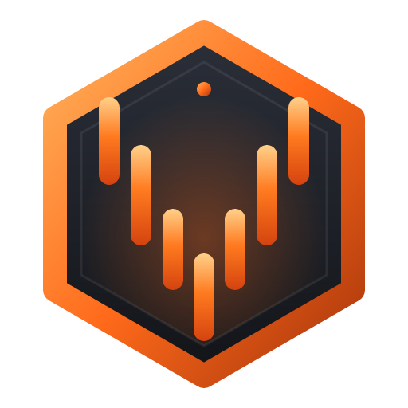
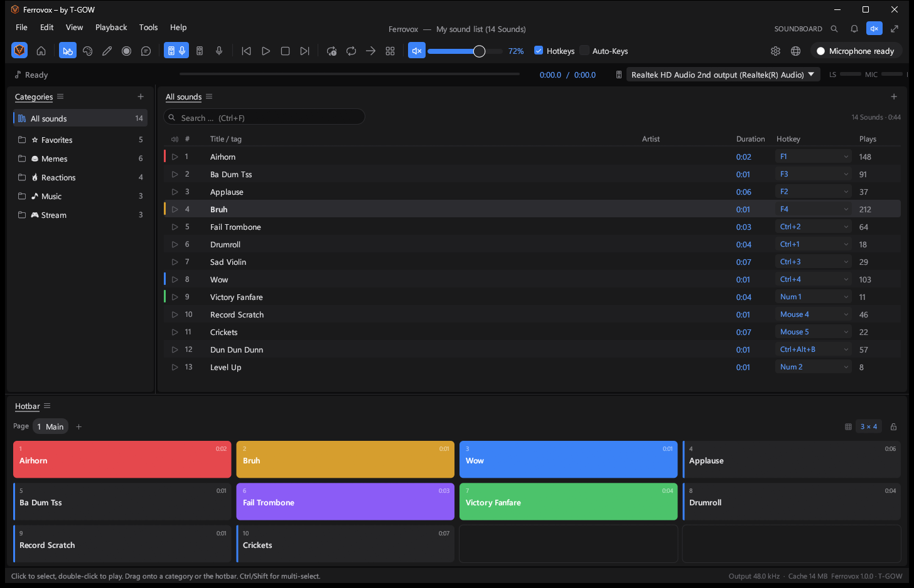
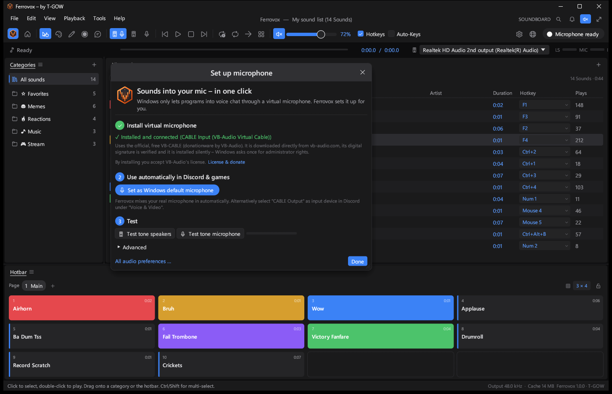
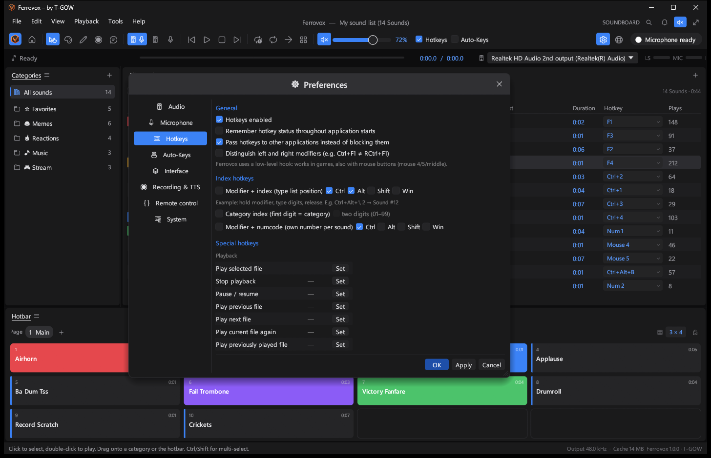
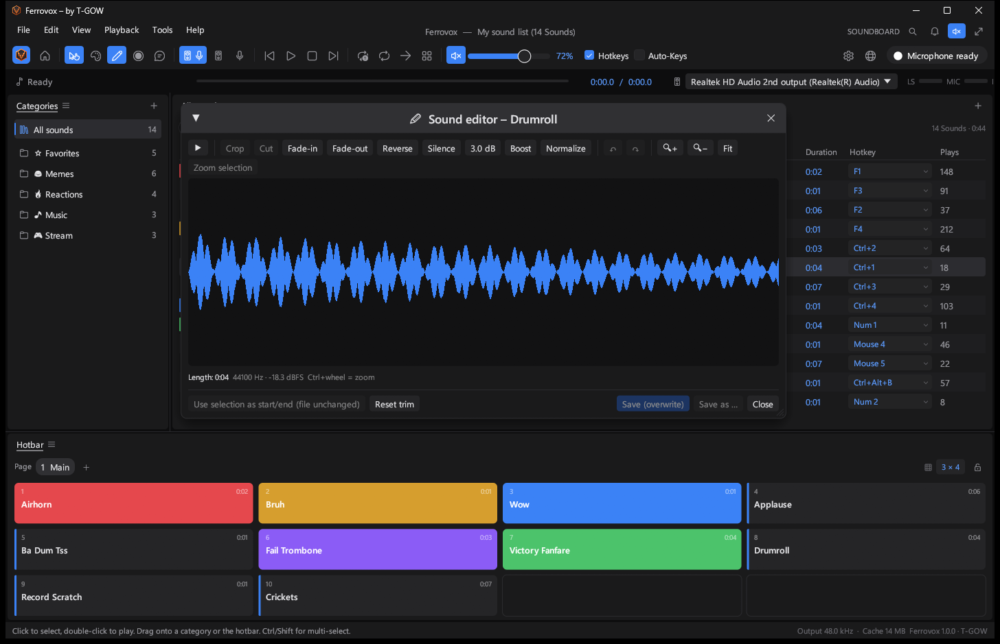
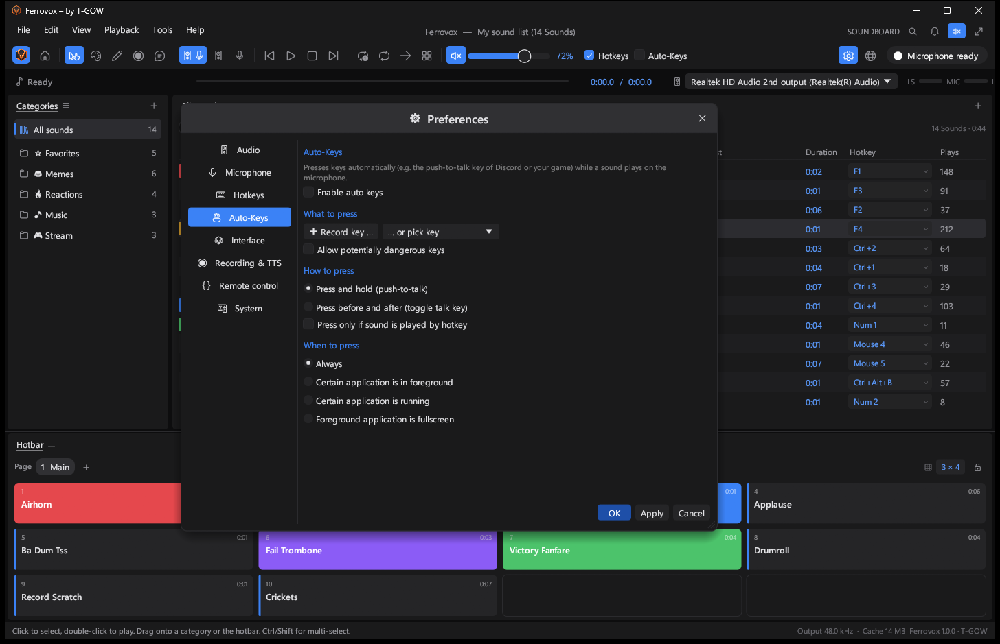
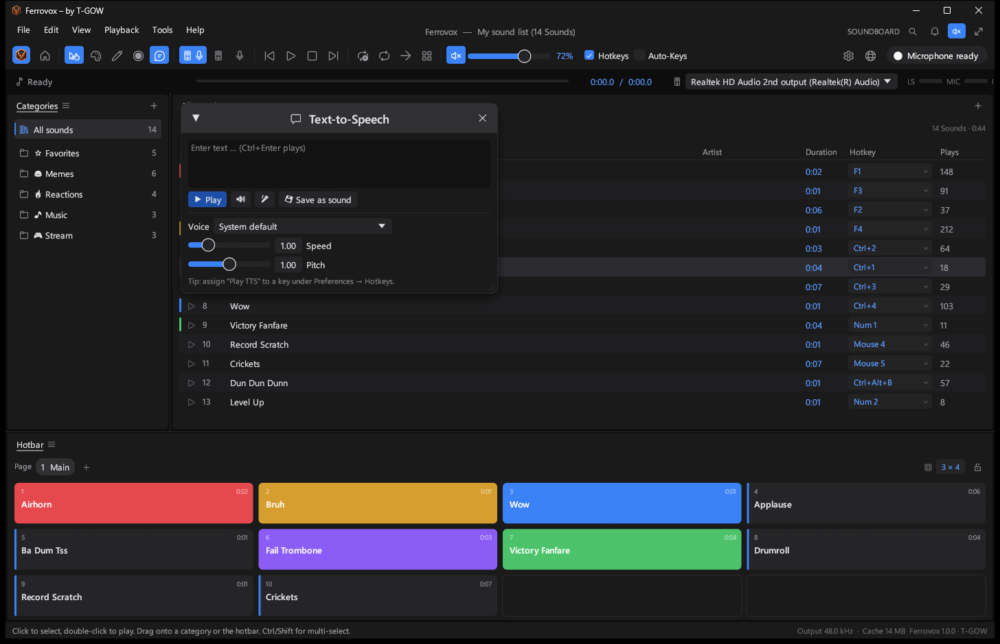
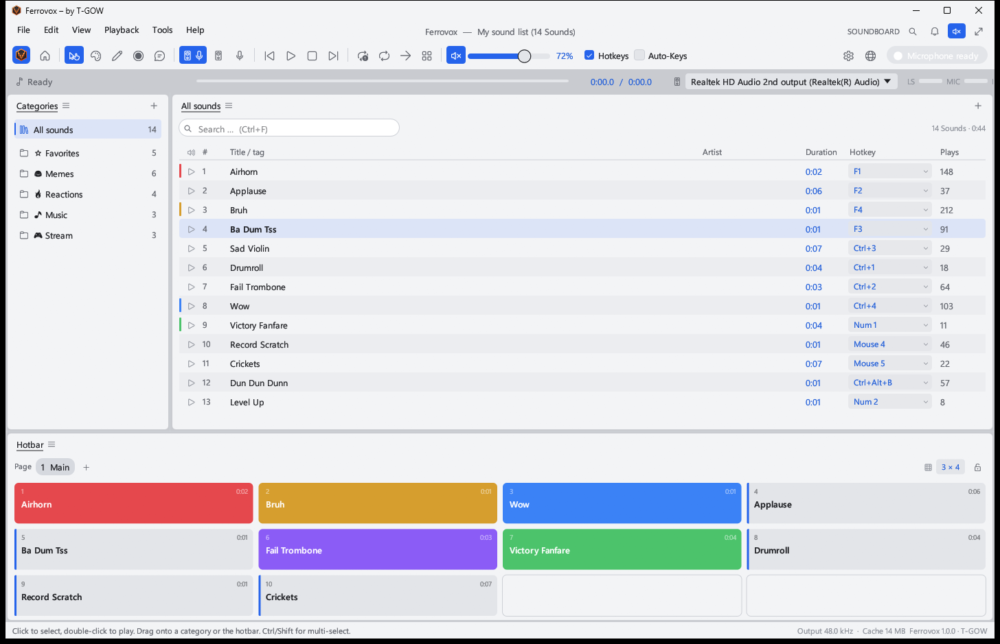

<p align="center">
  
</p>

<h1 align="center">Ferrovox</h1>

<p align="center">
  <b>The soundboard that plays straight into your microphone; a free, open-source alternative to Soundpad, built in pure Rust.</b><br>
  Global hotkeys that work in games, a hotbar, a sound editor, a recorder, text-to-speech and a one-click virtual microphone,<br>
  in one small native app for Windows. Free, offline, and yours.
</p>

<p align="center">
  
  
  
  <a href="https://github.com/T-G0W/ferrovox/releases/latest"></a>
  <a href="https://github.com/T-G0W/ferrovox/releases"></a>
</p>

<p align="center">
  <a href="https://github.com/T-G0W/ferrovox/releases/latest"></a>
</p>

<br>

<p align="center">
  
  <br>
  <sub>Categories, a sound list with per-sound hotkeys (keyboard, numpad and mouse buttons) and a colored hotbar for one-click playback.</sub>
</p>

> [!NOTE]
> **Ferrovox is an independent project by T-GOW.** It contains no code, artwork or sounds from Soundpad.
> It can import Soundpad sound lists and speaks the same remote-control commands, so switching is painless.
> Soundpad is a trademark of its respective owner; Ferrovox is not affiliated with or endorsed by it.

<p align="center">
  <a href="#features">Features</a> ·
  <a href="#feature-tour">Feature tour</a> ·
  <a href="#coming-from-soundpad">Coming from Soundpad</a> ·
  <a href="#get-started">Get started</a> ·
  <a href="#remote-control">Remote control</a> ·
  <a href="#under-the-hood">Under the hood</a> ·
  <a href="#build-from-source">Build</a> ·
  <a href="#license-and-credits">License</a>
</p>

<br>

<table>
  <tr>
    <td width="25%" valign="top">
      <h3>🎙️ Into your mic, in one click</h3>
      Ferrovox installs the official VB-CABLE driver for you, checks its signature and wires everything up. Your real voice is mixed in automatically, so Discord and games just hear you plus your sounds.
    </td>
    <td width="25%" valign="top">
      <h3>⌨️ Hotkeys that work in games</h3>
      A low-level hook catches keys even in fullscreen games, including mouse buttons 4, 5 and middle. Push-to-talk can be pressed for you while a sound plays.
    </td>
    <td width="25%" valign="top">
      <h3>⚡ Native and tiny</h3>
      One 7&nbsp;MB executable, no Electron, no runtime. A real-time mixer with resampling, fades and clipping protection keeps latency low.
    </td>
    <td width="25%" valign="top">
      <h3>🔄 Updates itself</h3>
      New versions download in the background and install when you quit. Every update is Ed25519-signed and verified before anything runs.
    </td>
  </tr>
</table>

<br>

## Features

Every screenshot is the real app, captured from a release build.

<table>
  <tr>
    <td width="50%" valign="top">
      
      <br>
      <sub>The microphone wizard: install, use automatically, test.</sub>
      <h3>Your sounds, in every voice chat</h3>
      Windows only lets programs into a microphone through a driver. Ferrovox downloads the official VB-CABLE package straight from vb-audio.com, verifies the digital signature and installs it silently with a single administrator prompt.
      <br><br>
      One more click makes it the Windows default microphone, so Discord, TeamSpeak and games pick it up without touching their settings. Your real microphone is passed through, with feedback protection built in.
    </td>
    <td width="50%" valign="top">
      
      <br>
      <sub>Hotkey preferences with index hotkeys, numcodes and around 45 special actions.</sub>
      <h3>Hotkeys for everything</h3>
      Give every sound its own key, or type its list position or number with a modifier held down. Around 45 special hotkeys cover play, stop, pause, next, random, volume, play mode, recording, text-to-speech and more.
      <br><br>
      Distinguish left and right modifiers, pass keys through to other apps, and see every assignment at a glance in the hotkey overview.
    </td>
  </tr>
  <tr>
    <td width="50%" valign="top">
      
      <br>
      <sub>The built-in sound editor with waveform, zoom and non-destructive trimming.</sub>
      <h3>Edit without leaving the app</h3>
      Crop, cut, fade in and out, reverse, insert silence, boost and normalize, with undo and zoom. Or trim a sound non-destructively: Ferrovox remembers the start and end and leaves your file untouched.
      <br><br>
      Each sound can also have its own volume and play mode, and loudness normalization keeps quiet and loud files at the same level.
    </td>
    <td width="50%" valign="top">
      
      <br>
      <sub>Auto-Keys press your push-to-talk key while a sound plays.</sub>
      <h3>Push-to-talk, handled</h3>
      Auto-Keys press and hold your push-to-talk key for exactly as long as a sound plays, or tap it before and after. Conditions limit it to a specific game, a running app or fullscreen windows.
      <br><br>
      Keys are sent as hardware scancodes, which games accept, and a guard stops risky modifiers from triggering Alt+Tab or Win+L by accident.
    </td>
  </tr>
  <tr>
    <td width="50%" valign="top">
      
      <br>
      <sub>Text-to-speech with the voices built into Windows.</sub>
      <h3>Say it, or record it</h3>
      Type a sentence and Ferrovox speaks it into your microphone with any installed Windows voice, at the speed and pitch you choose, or saves it as a new sound.
      <br><br>
      The recorder captures what your speakers play or what your microphone hears, trims silence, normalizes and drops the result straight into your list.
    </td>
    <td width="50%" valign="top">
      
      <br>
      <sub>The light theme. Studio blue and copper are the dark themes.</sub>
      <h3>Looks the way you like</h3>
      A clean studio look with Segoe Fluent icons and a dark title bar, in three themes, with adjustable scaling, compact rows and selectable columns.
      <br><br>
      The interface follows your Windows language: German on German systems, English everywhere else, switchable at any time.
    </td>
  </tr>
</table>

### Feature tour

- **Playback:** speakers, microphone or both, per app or per sound; overlap several sounds; pause, seek, jump, repeat a file or the whole list, continue to the next file, random from a category or everything.
- **Library:** drag and drop audio and video files (MP3, WAV, FLAC, OGG, M4A/AAC, ALAC, AIFF, MP4, MOV, MKV and more), categories with icons and colors, search, sorting, play counts, dead-entry finder, undo and redo, daily backups.
- **Hotbar:** pages with titles and colors, a freely chosen grid, drag and drop, lockable, page switching by hotkey with audible cues.
- **Hotkeys:** per sound, per category (random), index and numcode hotkeys, around 45 special actions, mouse buttons 4, 5 and middle, conflict detection and an overview window.
- **Microphone:** one-click virtual microphone, real-microphone passthrough, voice blocking while a sound plays, push-to-talk and microphone delays, a voice-activation burst for apps that need sound to open the gate.
- **Audio:** loudness normalization with voice measurement, per-sound gain, ducking of other apps while a sound plays, live level meters, preloading of hotkey sounds for zero delay.
- **Tools:** sound editor, recorder (loopback or microphone), text-to-speech, color tool, statistics and a hotkey overview.
- **Everyday comfort:** system tray, start with Windows, start minimized, always on top, follows your Windows default output device live.
- **Updates and install:** one setup for 32- and 64-bit Windows without administrator rights, signed automatic updates, clean uninstall.

<br>

## Coming from Soundpad?

Ferrovox reads your existing Soundpad sound list, including categories, hotkeys and play counts from `stats.spl`. On first start with an empty list you get an **Import existing Soundpad list** button, or use **File › Import Soundpad list**.

Stream Deck plugins, bots and scripts keep working: Ferrovox answers on the same named pipe, `sp_remote_control`, with the same command names and response codes, as long as Soundpad itself is not running.

For the microphone, Ferrovox uses a signed virtual audio cable and does all the mixing itself. Nothing in your system security has to be changed or switched off, and it is undone with one click.

<br>

## Get started

1. Download **`Ferrovox-Setup-<version>.exe`** from the [releases page](https://github.com/T-G0W/ferrovox/releases/latest) and run it. One installer covers 32- and 64-bit Windows 10 and 11, no administrator rights needed.
2. Drag sounds or videos into the window.
3. To let others hear your sounds, click **Set up microphone › Set up now, one click** in the top right. Windows asks once for administrator rights to install the driver.
4. Optional: **Set as Windows default microphone**, so voice chats use it without any changes.
5. Click the **Hotkey** cell of a sound and press a key. Done.

> [!TIP]
> Windows SmartScreen may show "Unknown publisher" the first time, because the setup is not signed with a paid code-signing certificate. Choose **More info › Run anyway**.

Your sound list, settings and log live in `%APPDATA%\T-GOW\Ferrovox`. Set the environment variable `FERROVOX_DATA_DIR` for a portable setup.

<br>

## Remote control

Ferrovox listens on `\\.\pipe\ferrovox` and, for compatibility, on `\\.\pipe\sp_remote_control`.

```bash
ferrovox.exe -rc "DoPlaySound(3)"
```

| Command | What it does |
|---|---|
| `DoPlaySound(i[, speakers, mic])` | Play sound number *i*, optionally only on speakers or microphone |
| `DoPlaySoundFromCategory(c, i)` | Play sound *i* of category *c* |
| `DoPlayRandomSound()` · `DoPlayRandomSoundFromCategory(c)` | Play something random |
| `DoStopSound()` · `DoTogglePause()` · `DoJumpMs(ms)` · `DoSeekMs(ms)` | Transport |
| `SetVolume(0-100)` · `DoToggleMute()` · `GetVolume()` | Volume |
| `DoStartRecordingSpeakers()` · `DoStartRecordingMicrophone()` · `DoStopRecording()` | Recorder |
| `GetSoundlist()` · `GetCategories()` · `GetPlayStatus()` · `GetPlaybackPositionInMs()` · `IsAlive()` | Status |
| `DoPlaySoundByName(text)` · `DoTts(text)` · `DoSetPlayMode(speakers\|microphone\|both)` · `ShowWindow()` | Ferrovox extras |

Responses are values, or `R-200` (ok), `R-204` (no content), `R-403` (disabled) and `R-404` (not found).

<br>

## Under the hood

- **UI:** [egui](https://github.com/emilk/egui) / eframe on OpenGL, Segoe UI and Segoe Fluent Icons, a DWM dark title bar.
- **Audio:** WASAPI through [cpal](https://github.com/RustAudio/cpal), a lock-free real-time mixer per output with linear-interpolation resampling, fades and soft clipping, microphone passthrough through a wait-free ring buffer with drift control.
- **Decoding:** [Symphonia](https://github.com/pdeljanov/Symphonia) for every format, an LRU cache and gated loudness analysis.
- **Input:** low-level keyboard and mouse hooks for global hotkeys, `SendInput` with scancodes for Auto-Keys.
- **Windows integration:** Core Audio for default devices, session ducking and loopback recording, WinRT for text-to-speech, named pipes for remote control.
- **Distribution:** an Inno Setup installer that picks the right build for the system, and an updater that fetches a signed `latest.json` from GitHub Releases and checks size and SHA-256 before installing.

<br>

## Build from source

Requirements: Rust (stable, MSVC toolchain), the Windows SDK, and for the installer [Inno Setup 6](https://jrsoftware.org/isinfo.php).

```bash
cargo build --release
```

```bash
cargo test --release
```

A complete release (both executables, license file, setup and signed update manifest) goes to `dist\release\`:

```bash
powershell -ExecutionPolicy Bypass -File release\build-release.ps1 -Repo T-G0W/ferrovox
```

Pushing a tag such as `v1.0.1` builds and publishes the release on GitHub Actions automatically.

<br>

## Privacy

Ferrovox sends no telemetry. It only goes online to check for updates on GitHub and, when you ask for it, to download VB-CABLE from vb-audio.com.

<br>

## License and credits

Ferrovox is © 2026 T-GOW and dual-licensed under either of

- [MIT License](LICENSE-MIT)
- [Apache License, Version 2.0](LICENSE-APACHE)

at your option.

VB-CABLE is donationware by VB-Audio Software and is downloaded from its official website, never bundled. The licenses of all libraries Ferrovox uses are installed alongside the app in `THIRD_PARTY_LICENSES.txt`.

<p align="center"><sub>Made with 🦀 by T-GOW</sub></p>
